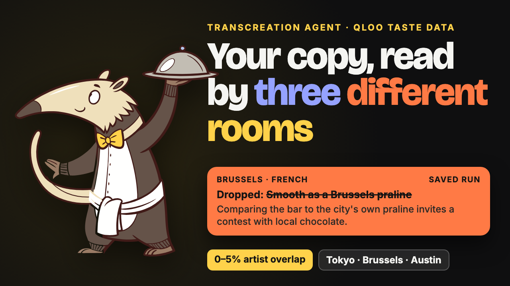
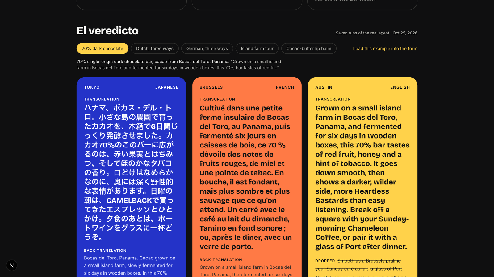
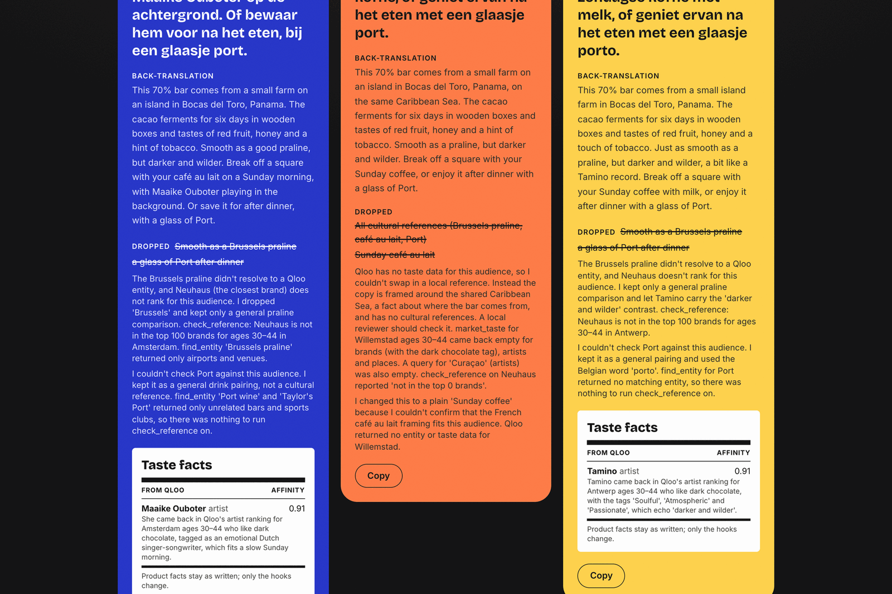
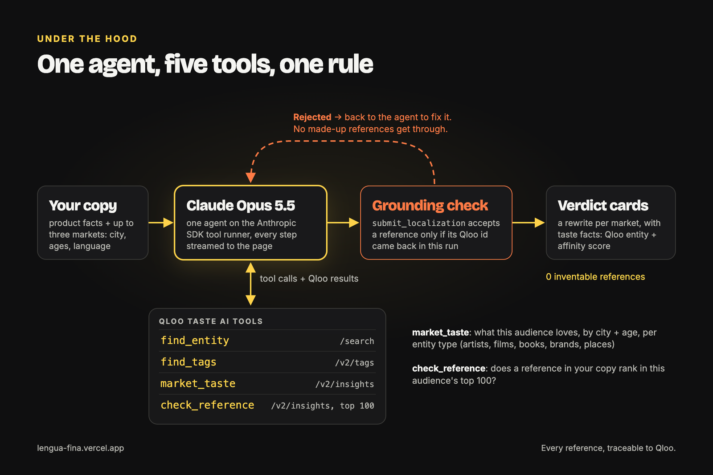
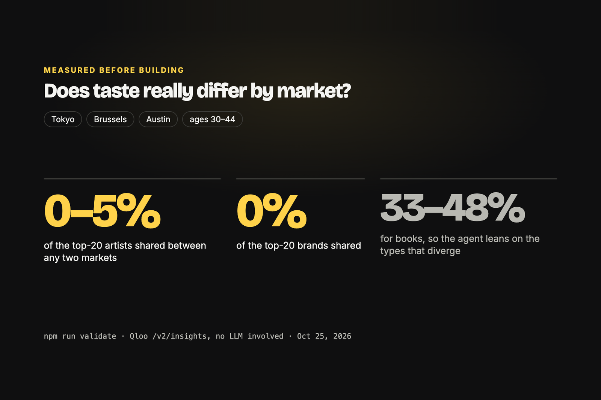

<p align="center">
  <a href="https://youtu.be/3m5JGfG7OkQ"></a>
</p>

<p align="center">
  <a href="https://lengua-fina.vercel.app"></a>
  <a href="https://youtu.be/3m5JGfG7OkQ"></a>
  <a href="https://devpost.com/software/lengua-fina"></a>
  <a href="LICENSE"></a>
</p>

# Lengua Fina

A transcreation agent for translators and small producers who sell abroad.

Translation keeps the words and loses the references. "Smooth as a Brussels praline" works in Brussels and means little in Tokyo. Lengua Fina rewrites product copy for each target market using cultural references that audience actually has affinity for, according to [Qloo](https://qloo.com)'s taste graph, and flags the source copy's references that won't land.

In Spanish, *lengua* means both language and tongue: the thing you speak with and the thing you taste with.

## Try it

Live at https://lengua-fina.vercel.app (no sign-in).

1. **Read a verdict first.** Pick a saved run under "El veredicto": "Dropped" says why a reference won't land, and the taste facts show which Qloo entity replaced it, with its affinity score.
2. **Run one live.** "Load this example into the form", then Transcreate. One to three minutes; the tasting notebook streams every Qloo call.
3. **Bring your own line.** Copy with a strong local hook (a breakfast, a team, a band). Compare cities that share a language, like Amsterdam and Antwerp, or try one Qloo may not cover, like Willemstad.

## What you get

One card per market: the rewrite, a back-translation, the references it dropped and why, and the taste facts behind every swap (Qloo entity + affinity score).



When Qloo has no data for an audience, the agent says so and ships no references for that market instead of guessing. Same Dutch copy, three rooms: Amsterdam and Antwerp get local references with taste facts, Willemstad gets none.



## How it works

An agent (Claude Opus 5.5, via the Anthropic SDK tool runner) gets the copy, the product and up to three markets (city, age ranges, language). It has five tools:

| Tool | Qloo endpoint | Purpose |
|---|---|---|
| `find_entity` | `/search` | Resolve references in the source copy to Qloo entities |
| `find_tags` | `/v2/tags` | Find product tags (e.g. chocolate) to narrow an audience |
| `market_taste` | `/v2/insights` | What an audience (city + ages + interests) has affinity for, per entity type |
| `check_reference` | `/v2/insights` | Whether a given reference ranks in the top 100 for an audience |
| `submit_localization` | – | Final copy per market, with references cited by Qloo entity id |

**Grounding check:** `submit_localization` rejects any reference whose entity id was not returned by a Qloo tool during that run, and sends the agent back to fix it. Every reference shown in the UI links back to real Qloo data.



### Measured before building

`npm run validate` compares Qloo's taste profiles across markets with no LLM involved. For 30 to 44-year-olds in Tokyo, Brussels and Austin, the top-20 artists overlap 0 to 5% between any two markets and the top-20 brands 0%. Books overlap 33 to 48%, so the agent leans on the entity types that diverge.



## Run locally

```bash
cp .env.example .env.local   # add QLOO_API_KEY and ANTHROPIC_API_KEY
npm install
npm run validate             # checks that Qloo returns different taste profiles per market
npm test                     # grounding check unit tests
npm run dev
```

`npm run validate -- Tokyo Brussels "Mexico City"` compares any markets you like. Raw Qloo responses go to `scripts/out/`, which is gitignored: Qloo data must not be committed.

## Public demo limits

The live demo allows 6 runs per IP per hour and 300 runs a day (`RATE_LIMIT_PER_HOUR`, `RATE_LIMIT_PER_DAY`).

## Stack

Next.js 15, TypeScript, Tailwind, `@anthropic-ai/sdk`, Zod. Deployed on Vercel.

## License

MIT. Made by Dorien Van den Abbeele (Divina Endeavors LLC / Hero Apps) in Bocas del Toro, Panama.
